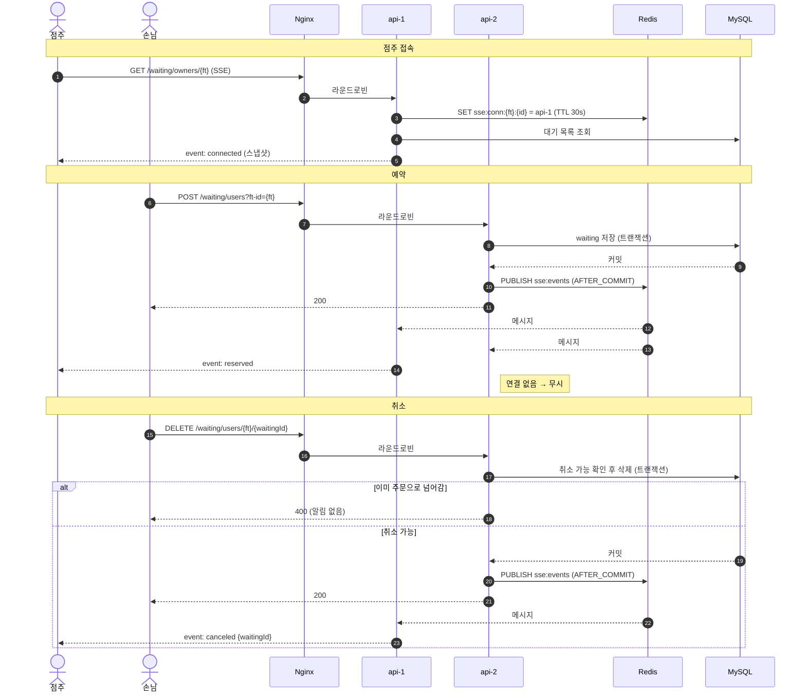

# 푸딩 (Fooodding)

## 주제

푸드트럭 모바일 예약 서비스

## SSE 다중 인스턴스 개선

  

### 예약·취소 흐름

### Redis Pub/Sub 기반 다중 인스턴스 SSE 실시간 알림

- SSE 연결은 각 JVM의 메모리에 있어, Nginx가 손님의 예약 요청을 다른 인스턴스로 보내면 사장님이 알림을 받지 못했다.
- 이제 요청을 처리한 인스턴스가 `sse:events`에 발행하면 모든 인스턴스가 이벤트를 받고, 해당 사장님의 연결이 있는 곳에서만 열린 탭마다 알림을 보낸다. 로컬 Docker Compose의 인스턴스 2대 사이에서 측정한 전달 시간은 12ms였다.

### 트랜잭션 커밋 이후 이벤트 발행

- `WaitingService`에서 발생한 `WaitingChangedEvent`는 `@TransactionalEventListener(AFTER_COMMIT)`에서 Redis로 발행한다. 롤백한 예약은 알림도 보내지 않는다.
- 알림 발행에 실패해도 예약은 유지된다. 사장님 화면은 재연결할 때 스냅샷으로 최신 대기 목록을 받는다.

### Nginx 리버스 프록시 환경의 SSE 전달 문제 해결

- Nginx 기본 설정(`proxy_buffering on`, 업스트림 HTTP/1.0)에서는 SSE 이벤트가 버퍼에 묶여 점주에게 전달되지 않아, SSE 경로에 `proxy_buffering off`, `proxy_http_version 1.1`, `Connection ""`, `gzip off`를 적용해 이벤트가 즉시 전달되도록 해결했다.