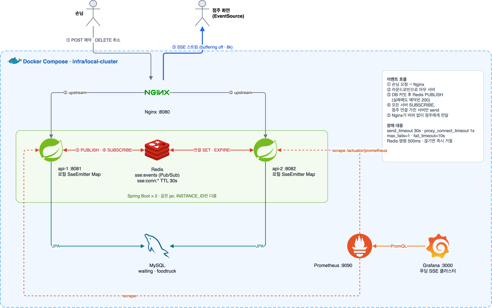

# Local SSE cluster

nginx(:8080) → api-1(:8081) / api-2(:8082), shared MySQL + Redis, Prometheus(:9090) + Grafana(:3000, dashboard "푸딩 SSE 클러스터").

```bash
(cd ../../backend/api && sh gradlew bootJar -x test) && cp ../../backend/api/build/libs/api-0.0.1-SNAPSHOT.jar ./api.jar
docker compose up -d --build
python3 scenario/scenario.py           # S1–S7, ~2 min, exits non-zero on the first failure
python3 scenario/buffer_experiment.py  # proxy_buffer_size sweep (markdown table)
```

| Scenario | Checks |
|---|---|
| S1 | owner SSE on api-1, reserve/cancel on api-2 → owner gets both events |
| S2 | two owner connections (api-1, api-2) → each gets the event exactly once |
| S3 | Redis registry `sse:conn:{ft}:{emitter}` = instance, TTL 30s; closed connection removed |
| S4 | through nginx: snapshot + 10 events, request→owner latency (buffering off) |
| S5 | SIGKILL the instance holding the stream → reconnect via nginx lands on survivor, snapshot restores state, stale key expires by TTL |
| S6 | Redis down → reserve still 200 and fast; Pub/Sub resumes after Redis restarts |
| S7 | 3 tabs across instances, 25 reservations → 25/25/25 (dashboard load) |

## proxy_buffer_size measurement (buffering off)

Spring response header block: 252 B. Frames: heartbeat 38 B, reserved 129 B, connected snapshot ≈110 B per waiting.

| waitings | size | result | snapshot B | upstream recv | client writev |
|---|---|---|---|---|---|
| any | 128 | 502 upstream sent too big header | – | – | – |
| 100 | 256 | 200 | 10955 | 44 | 44 |
| 100 | 512 | 200 | 10955 | 22 | 23 |
| 100 | 1k | 200 | 10955 | 11 | 12 |
| 100 | 2k | 200 | 10955 | 6 | 7 |
| 100 | 4k (default) | 200 | 10955 | 3 | 4 |
| 100 | **8k (chosen)** | 200 | 10955 | 2 | 3 |
| any | 16k | `nginx -t` fails: proxy_busy_buffers_size (2×) must be < proxy_buffers total − 1 | – | – | – |

8k: a 100-waiting snapshot in 2 reads and every other event in 1, at 8 KB per connection. Counts vary by ±1 between runs with TCP arrival timing.



`docs/architecture.drawio` — draw.io로 편집
